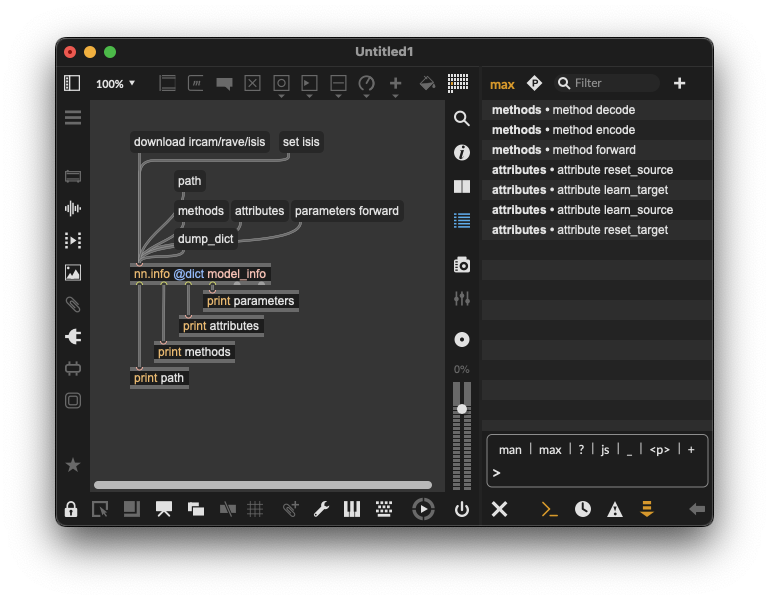
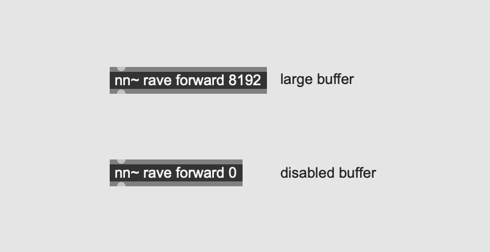
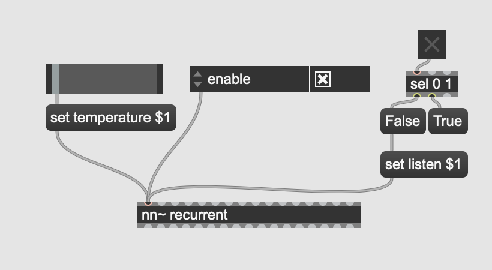
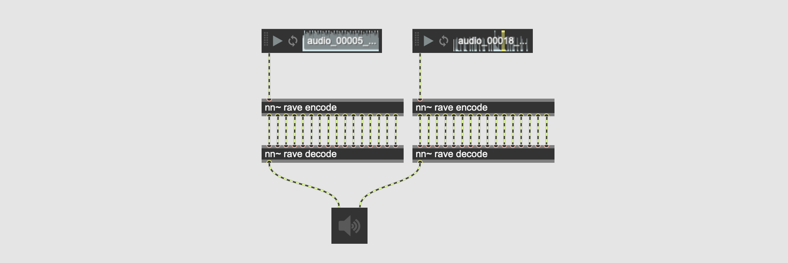
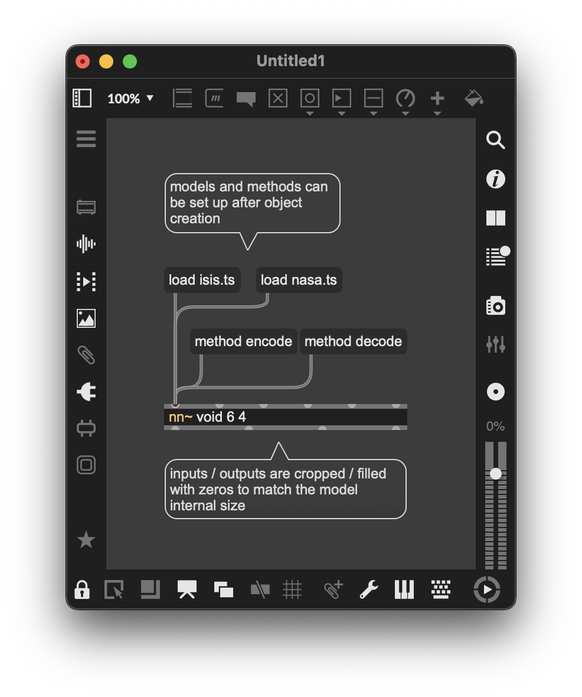

# Detailed description

- [Overview](#overview)
- [Models and methods](#models-and-methods)
- [Signals, channels and ratios](#signals-channels-and-ratios)
- [Buffering](#buffering)
- [Threads and latency](#threads-and-latency)
- [Attributes](#attributes)
- [Multichannel objects (Max)](#multichannel-objects-max)
- [Lazy initialisation: void mode (Max)](#lazy-initialisation-void-mode-max)
- [Changing model or method while playing](#changing-model-or-method-while-playing)
- [Sample rate](#sample-rate)
- [GPU](#gpu)

## Overview

`nn~` is a bridge between Max/MSP or PureData and [libtorch](https://pytorch.org/cppdocs/), the C++ engine of PyTorch. On its own it does nothing: it needs a **model**, a TorchScript file (`.ts`) exported from PyTorch. The model defines what is computed; `nn~` takes care of:

- turning audio signals into tensors and back,
- collecting enough samples for the model, and running it outside the audio thread,
- exposing the model's parameters to the patch,
- loading, switching and downloading models.

Any PyTorch code can be used this way, not only neural networks: effects, analysis, synthesis... See [Wrapping models](wrapping.md).

## Models and methods

A model has one or several **methods**: processing functions, each with its own inputs and outputs. A [RAVE](https://github.com/acids-ircam/RAVE) model, for instance, has three:

| method | input | output |
|---|---|---|
| `encode` | audio | latent signals (e.g. 16 channels) |
| `decode` | latent signals | audio |
| `forward` | audio | audio (encode then decode) |

An `nn~` object runs **one** method, given as second argument (`forward` by default). Its inlets and outlets follow that method: `[nn~ rave encode]` has 1 inlet and 16 outlets, `[nn~ rave decode]` has 16 inlets and 1 outlet. The inlet and outlet labels (shown on mouse-over) come from the model.

To know which methods a model has, send `dump` to `nn~`, or use [`nn.info`](reference.md#nninfo) in Max.



## Signals, channels and ratios

Every method declares four numbers, set when the model is exported:

| parameter | meaning |
|---|---|
| input channels | number of signals in (inlets) |
| input ratio | the model reads 1 sample out of `ratio` |
| output channels | number of signals out (outlets) |
| output ratio | each output value lasts `ratio` samples |

Ratios let a model work at a lower rate than audio. With an output ratio of 2048, `encode` produces one latent value per 2048 samples, and `nn~` holds each value for 2048 samples (sample and hold). With an input ratio of 2048, `decode` reads the last sample of each block of 2048 samples, so its inputs behave like control signals.

All inlets and outlets are audio signals (`~`), whatever their ratio. Use `sig~`, `snapshot~` or `line~` to go between messages and signals.

## Buffering

A model is much more efficient on large chunks of audio than on Max's small DSP vectors (64 or 128 samples). `nn~` therefore accumulates incoming samples in a **buffer**, runs the model once the buffer is full, and plays the result back while the next buffer fills.

The buffer size is the third argument (`[nn~ rave forward 4096]`):

- It must be at least the largest ratio of the model. A smaller value is raised to that ratio, with a warning.
- Other values are rounded up to the next power of two.
- If not given, it defaults to the model's largest ratio for `nn~` and `mc.nn~`, and to 4096 for `mcs.nn~` and for `nn~` in Pd.
- `0` selects the smallest possible buffer and disables the separate thread (see below).
- The DSP vector size of Max/Pd must not exceed the buffer size, otherwise the object disables itself.



Larger buffers use less CPU and are more robust against glitches, at the price of more latency.

## Threads and latency

By default the model runs in a **separate thread**: while the model processes buffer *k*, the audio thread keeps collecting buffer *k+1* and plays the result of buffer *k−1*. The audio thread never waits for the model.

| mode | when | latency | CPU constraint |
|---|---|---|---|
| threaded | default | 2 × buffer size | one forward pass must take less than one buffer duration |
| in audio thread | buffer size `0` | 1 × buffer size | one forward pass must fit within one audio callback |

For example, at 44.1 kHz with a buffer of 4096 samples, the threaded latency is 8192 samples (186 ms) and the model has 93 ms to process each buffer.

If the model is slower than real time, buffers are skipped and you hear gaps. Increase the buffer size, use a lighter model, or check the CPU load of other processes.

The model is only computed when the DSP is on and `enable` is 1. `enable 0` works as a bypass that stops the computation (outputs are silent) without unloading the model.

## Attributes

Models can expose **attributes**: parameters defined at export time, such as a temperature, a mode, or a gain. They are changed with messages:

```
set temperature 0.8
set mode tanh
set coefs 1. 0.5 0.25
get temperature
```

`get_attributes` lists the attributes of the loaded model. Each attribute has one or several values, each with a type:

| type | set from Max/Pd with |
|---|---|
| `bool`, `int`, `float`, `str` | a number or a symbol |
| `torch.Tensor` | the name of a Max array (any length) |
| `Buffer` | the name of a Max `buffer~` or a Pd array |



The model can refuse a value (for instance a mode it does not know): `nn~` then prints an error and the attribute keeps its previous value.

With a **buffer attribute**, the model reads the content of a `buffer~`, with its channels and sample rate, when you send `set <attribute> <buffer name>`. In Max, set `@track_buffers 1` to send the buffer again to the model each time it is modified or replaced.

## Multichannel objects (Max)

Max 8+ multichannel cables can carry several signals in one patch cord. `nn~` comes with two multichannel variants that use them to run **several examples at once** (a *batch*): the model is called once for all of them, which costs less CPU than several `nn~` objects.

The example below encodes then decodes two audio files with two separate objects:



**`mc.nn~`** takes multichannel cables where each channel is one example. It has as many inlets/outlets as the method has inputs/outputs, and the number of channels of the cables is the batch size:


**`mcs.nn~`** does the opposite: each inlet/outlet is one example, and each multichannel cable carries all the dimensions of that example. Below, `[mcs.nn~ rave encode 2]` has 2 outlets, each carrying the 16 latent dimensions of one example:


To recap:

| object | inlets / outlets | channels of each cable |
|---|---|---|
| `nn~` | one per model input / output | 1 |
| `mc.nn~` | one per model input / output | one per example |
| `mcs.nn~` | one per example | one per model input / output |

In PureData, `nn~ -m` gives a single multichannel inlet and outlet carrying all the model's inputs and outputs.

## Lazy initialisation: void mode (Max)

`[nn~ void 2 1]` creates an object with 2 inlets and 1 outlet but no model. A model can then be loaded with `load <model>` and a method chosen with `method <name>`. This keeps a fixed number of inlets/outlets for a patch that switches models.



## Changing model or method while playing

`load`, `method` and `reload` can be sent while the DSP is running. The new model is prepared on the side; the audio switches to it at the next buffer boundary, once the current computation is finished. You may hear one buffer of silence during the switch.

Inlets and outlets are created with the object and do not change afterwards. If the new model or method has more inputs than inlets, the extra inputs receive silence. If it has more outputs than outlets, the extra outputs are dropped. A warning is printed in both cases.

`reload` reloads the model file from disk. Use it to try a new checkpoint while training without recreating the object.

## Sample rate

When a model is loaded, `nn~` passes the current sample rate of Max/Pd to the model. Models exported with the `nn_tilde` Python package can read it with `self.get_sample_rate()` (see [Wrapping models](wrapping.md#sample-rate)). Reload the model after changing the sample rate of the audio driver.

Most trained models, like RAVE, work at a fixed sample rate. Running them at another rate changes pitch and timbre.

## GPU

`@gpu 1` (Max) or `gpu 1` / the `-g` flag (Pd) runs the model on the GPU: CUDA if available, otherwise Metal (MPS) on Apple Silicon. Data has to be copied to the GPU and back for each buffer, so this only helps with heavy models and large buffers; for most real-time uses the CPU is faster.
